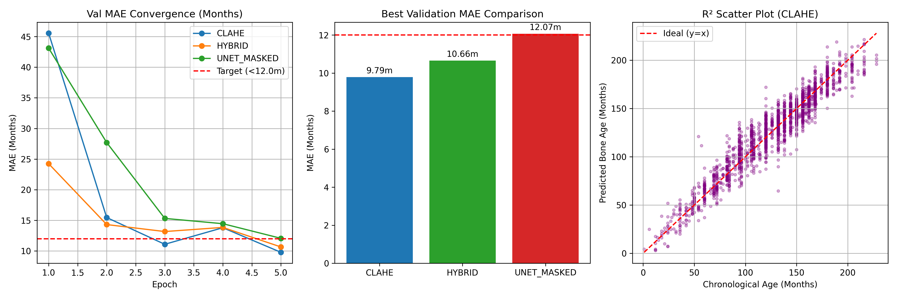
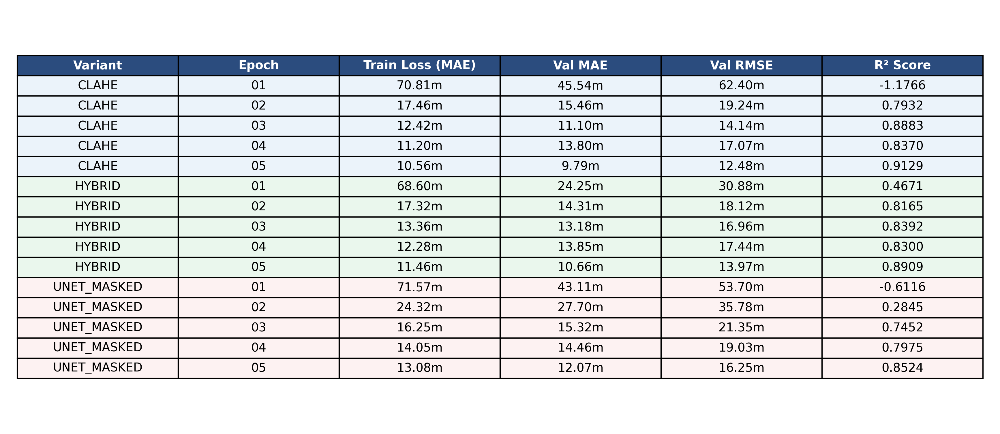

# Review 3 Preprocessing Variant Benchmarks

## Quantitative Metrics Across 15 Epochs

| Variant     |   Epoch | Train Loss (MAE)   | Val MAE   | Val RMSE   |   R² Score |
|:------------|--------:|:-------------------|:----------|:-----------|-----------:|
| CLAHE       |      01 | 70.81m             | 45.54m    | 62.40m     |    -1.1766 |
| CLAHE       |      02 | 17.46m             | 15.46m    | 19.24m     |     0.7932 |
| CLAHE       |      03 | 12.42m             | 11.10m    | 14.14m     |     0.8883 |
| CLAHE       |      04 | 11.20m             | 13.80m    | 17.07m     |     0.837  |
| CLAHE       |      05 | 10.56m             | 9.79m     | 12.48m     |     0.9129 |
| HYBRID      |      01 | 68.60m             | 24.25m    | 30.88m     |     0.4671 |
| HYBRID      |      02 | 17.32m             | 14.31m    | 18.12m     |     0.8165 |
| HYBRID      |      03 | 13.36m             | 13.18m    | 16.96m     |     0.8392 |
| HYBRID      |      04 | 12.28m             | 13.85m    | 17.44m     |     0.83   |
| HYBRID      |      05 | 11.46m             | 10.66m    | 13.97m     |     0.8909 |
| UNET_MASKED |      01 | 71.57m             | 43.11m    | 53.70m     |    -0.6116 |
| UNET_MASKED |      02 | 24.32m             | 27.70m    | 35.78m     |     0.2845 |
| UNET_MASKED |      03 | 16.25m             | 15.32m    | 21.35m     |     0.7452 |
| UNET_MASKED |      04 | 14.05m             | 14.46m    | 19.03m     |     0.7975 |
| UNET_MASKED |      05 | 13.08m             | 12.07m    | 16.25m     |     0.8524 |

## Evaluation Figures

